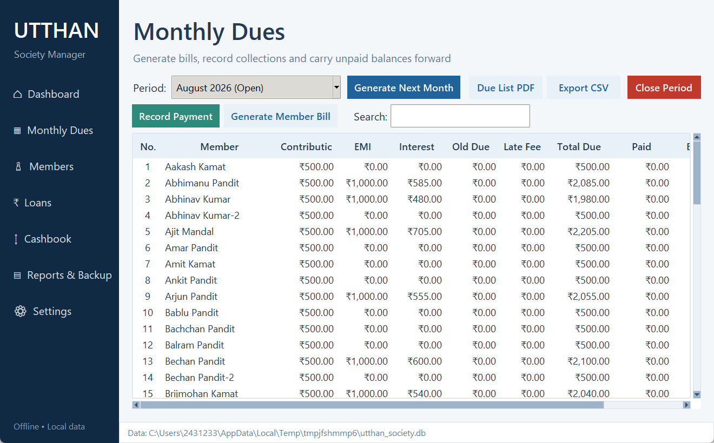

# Utthan Society Manager

Private web portal and offline Windows software for member savings, internal loans, monthly dues, receipts and record keeping.



## Ready-to-use application

Open `dist/Utthan-Society-Manager.exe`. No Python installation is required on the computer that runs the EXE.

On first launch, the application creates its database and imports the 60 members and August 2026 opening balances from the attached due-list PDF.

## Private web portal

The web portal has the same screens, colours and rules as the desktop application and uses the same database, so all existing members, balances and history carry over. There are two kinds of profile:

- **Administrator** – everything the desktop app does: dashboard, monthly dues, payments and receipts, members, loans, cashbook, reports and backup, settings, plus member logins and an activity/security log.
- **Member** – a private page showing only that member's savings, loans, monthly dues, payments, bills and receipts.

### Try it on this computer

1. `python -m pip install -r requirements.txt`
2. `python web_app.py`
3. Open `http://127.0.0.1:8765` and create the first administrator.

### Give members their logins

Member logins are generated by the administrator – members cannot sign themselves up.

- **Members → Generate login** creates a login for one member.
- **Member Logins → Generate all missing logins** creates logins for every active member and shows printable login slips (or **Generate as CSV**).
- Usernames follow the member number (`member12`); a strong temporary password is generated and shown **once**. Each member must choose their own password at first sign-in.
- **Reset password** issues a new temporary password if a member forgets theirs. **Disable** blocks a login immediately.

### Deploy

Configuration is by environment variable:

| Variable | Purpose |
|---|---|
| `UTTHAN_DATA_DIR` | Folder for the database, reports and backups (back this folder up). |
| `UTTHAN_SETUP_TOKEN` | **Required on a server.** Secret code needed to create the first administrator remotely. Without it, setup is only allowed from the server itself. |
| `UTTHAN_SECRET_KEY` | Long random value used to sign sessions (otherwise generated and stored in the data folder). |
| `UTTHAN_HOST` / `UTTHAN_PORT` | Listen address and port (default `127.0.0.1:8765`). |
| `UTTHAN_TRUSTED_PROXIES` | Set to `1` when running behind one reverse proxy (Nginx, IIS, Caddy) so real client IPs and HTTPS are detected. |
| `UTTHAN_COOKIE_SECURE` | Set to `true` when the site is served over HTTPS. |

Docker:

```
docker build -t utthan-portal .
docker run -d --name utthan -p 127.0.0.1:8765:8765 -v utthan-data:/data \
  -e UTTHAN_SETUP_TOKEN=<long-random-code> -e UTTHAN_TRUSTED_PROXIES=1 \
  -e UTTHAN_COOKIE_SECURE=true utthan-portal
```

Windows server: install Python, run `python -m pip install -r requirements-web.txt`, set the variables above, and run `python web_app.py` as a service (for example with NSSM).

Always put the portal behind an HTTPS reverse proxy with a domain certificate; never expose port 8765 directly to the internet. To move existing desktop data to the server, copy `utthan_society.db` into `UTTHAN_DATA_DIR` before first start.

Security built in: hashed passwords, forced password change on first login, login lockout after 5 failed attempts, CSRF protection, strict security headers, 8-hour sessions, member-level data isolation, audit log of every change and login, daily automatic backup and a validated restore that makes a safety copy first.

## Included features

- dashboard with savings, loans, interest, expenses and available funds;
- member register;
- fresh and top-up loans;
- reducing-balance interest and EMI calculation;
- monthly due generation;
- old-due and late-fee tracking;
- full or partial payment entry;
- printable monthly due lists, member bills and payment receipts;
- two-copy receipts (member and office) with the payment split, amount in words and remaining period balance;
- one-click PDF of all unpaid member bills for a period;
- receipt reprint from the cashbook (select a payment, or double-click it);
- live "paying now" total while entering a payment;
- automatic daily backup (last 30 kept) and a safety backup before a period is closed;
- cashbook and expenses;
- CSV export;
- local backup and restore;
- audit log in the database;
- configurable contribution, EMI and interest defaults.
- administrator and member login accounts with hashed passwords;
- member-level record isolation, CSRF protection, login throttling and security headers;
- one-time bulk account provisioning for all active members.
- administrator member-history search and security/audit activity views;
- validated web database backup download and restore.

## Data location

The EXE stores working data outside its installation folder:

`%LOCALAPPDATA%\UtthanSociety\utthan_society.db`

Generated reports and backups are stored below the same folder. Their exact locations are displayed inside the application. Automatic daily backups are kept in `Backups\Automatic`.

Create a backup regularly and copy important backups to another physical drive. Data remains only on the local computer unless a user manually copies it elsewhere.

## Recommended monthly process

1. Review the previous month's unpaid balances.
2. Close the previous period after all intended entries are made.
3. Select **Generate Next Month**.
4. Review the automatically calculated contribution, EMI, interest and carried due.
5. Create the due-list PDF or member bills.
6. Record each payment; the application updates savings and loan balances and creates a receipt.
7. Enter expenses and reconcile the cashbook with cash/bank holdings.
8. Create a backup.

## Source rules imported

The attached August 2026 PDF indicates:

- monthly contribution: ₹500 per member;
- EMI: ₹1,000 for borrowers;
- interest: 1.5% per month on opening outstanding loan balance;
- 60 members;
- opening member contributions: ₹15,90,000;
- loans in circulation: ₹10,77,000;
- previous interest: ₹1,48,085.

See [docs/RESEARCH_AND_DESIGN.md](docs/RESEARCH_AND_DESIGN.md) for the complete analysis, verified totals, official references, design and legal/accounting cautions.

## Development

Requirements: Python 3.14 or a compatible current Python 3 version.

- Start from source: `python app.py`
- Start the private web portal: `python web_app.py`
- Run tests: `python -m unittest discover -s tests -v`
- Rebuild EXE: run `scripts/build.ps1`

## Important scope note

This application maintains records; it is not legal, tax or audit advice and does not confer authority to accept public deposits or conduct regulated banking. Confirm the organisation's legal form and accounting policy with a qualified local professional before treating it as the final statutory ledger.
